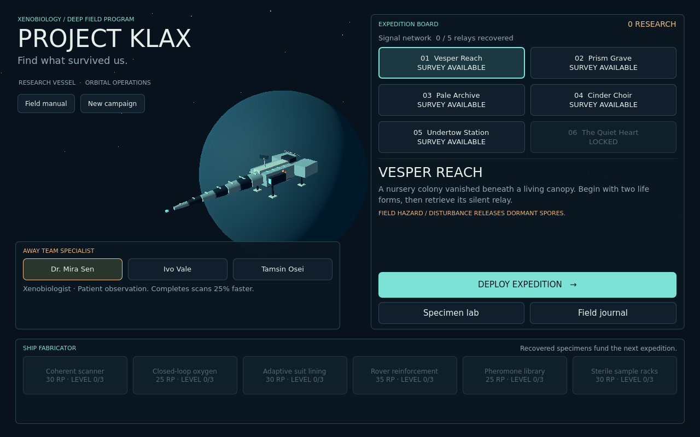
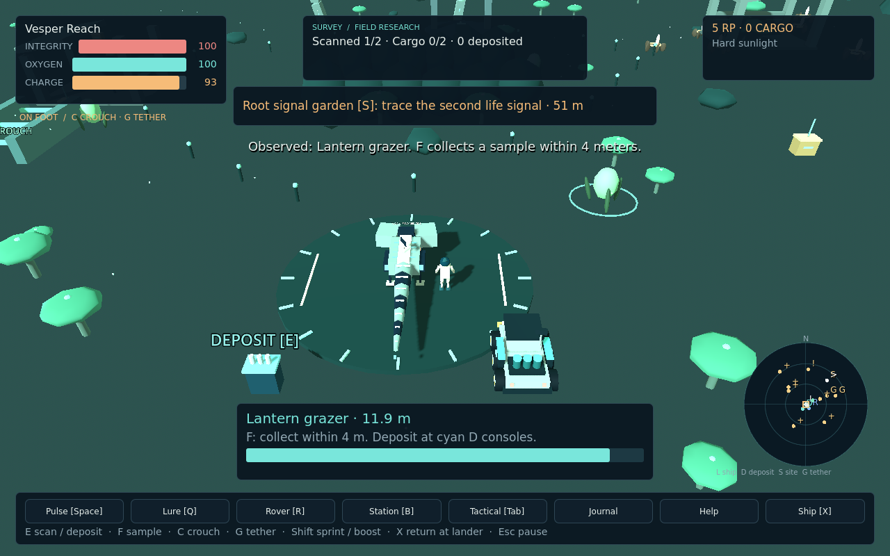

# Project Klax

Explore abandoned planetary colonies as a xenobiology field researcher. Observe unfamiliar organisms, collect living samples, recover the colonies' silent relays, and bring evidence back to your research vessel. The further you travel, the harder it becomes to separate the ruins from the ecology growing through them.

**Version 0.1** is a playable single-player campaign in **Godot 4.7.2**. It combines actual code and models from Tilebean, Zen Elysium, Zendelves, ASCII Racer and Project Barrel Roll. Cat Jewler's source could not be located; the microscope assay is original Klax code and is not credited as a Cat Jewler port.



## Start playing

- [Windows package](releases/ProjectKlax-Windows.zip): extract the entire ZIP and run `ProjectKlax.exe`. Keep its accompanying `.pck` file beside it.
- [Web package](releases/ProjectKlax-Web.zip): extract the ZIP and serve its folder with a local HTTP server, for example `python -m http.server 8000`. Open `http://localhost:8000`. Opening `index.html` directly from disk does not load the Godot Web build correctly.
- From source: import `project.godot` in **Godot 4.7.2**, then press **F5**. No add-ons are required.

The packages are generated from this repository; [SHA-256 checksums](releases/SHA256SUMS.txt) are included. The Windows package was exported but not run on Windows during this pass. There is no hosted play URL in this version. The Web build uses the single-threaded Compatibility renderer. Desktop keyboard and mouse are the supported controls.

## Your first expedition

Choose a specialist and deploy to **Vesper Reach**. Walk toward a nearby organism and hold **E** to scan it. Once observed, approach within four meters and press **F** to collect a sample. A shy animal may need a **Q** lure; a hostile warning display gives you time to retreat or use a nonlethal **Space** pulse.

The radar marks the lander **L**, rover **R**, relay **!**, and other recoverable sites **+**. Recover the relay with **E**, return to the lander's circle, and press **X** to extract. Samples, relay data and recovered materials are secured only when you return. Observations survive an emergency rescue.

Open the specimen lab aboard ship. The assay offers a match-three bonus, or you can choose **Analyze now** for the normal research reward. Spend research points on equipment and prepare another expedition.



## The campaign

The first five worlds are available from the start. Recover their five relays to reveal **The Quiet Heart**. Recover its relay, observe both of its species, and analyze at least six species across the campaign to make the final council recommendation. You can choose to preserve the living network or contain it, then continue researching.

| World | Expedition character |
| --- | --- |
| Vesper Reach | Overgrown nursery ruins, shy scavengers and disturbance-sensitive spores |
| Prism Grave | Crystal barriers, vibration-sensitive life and a distant observatory relay |
| Pale Archive | Frozen laboratories, cold exposure and a predator near the thermal ecology |
| Cinder Choir | Furnace remains, ash fronts and heat-resistant organisms |
| Undertow Station | Drained channels, coral-like growth and territorial filter feeders |
| The Quiet Heart | A connected sanctuary whose two organisms complete the investigation |

There are twelve catalog species, three selectable specialists, six upgrade lines with three levels each, and a field rover with drift, boost and damage to its left and right modules. Each world has a distinct route layout, fifteen creature instances, ruins, caches and a relay. Compact survey areas keep the return journey meaningful.

## Controls

| Input | Action |
| --- | --- |
| WASD / arrow keys | Move on foot; throttle and steer while driving |
| Shift | Sprint on foot / boost the rover |
| Ctrl | Rover brake and drift |
| Hold E | Scan the nearby targeted organism on foot |
| Tap E | Recover a nearby ruin, cache or relay; issue a scan order in tactical mode |
| F | Sample an observed, calm organism within four meters |
| R | Board a nearby rover / dismount |
| Space | Nonlethal pulse, with a charge cost and cooldown |
| Q | Place a temporary calming lure |
| B | Deploy a field station; up to two per expedition |
| Tab | Enter or leave tactical survey, slowing simulation to 12% speed |
| X | Extract within the lander's circle |
| J / H | Field journal / field manual |
| Mouse wheel | Adjust camera distance |
| Esc | Pause or close the current view |
| M / F11 | Toggle sound / fullscreen |
| Enter on mission deck | Deploy to the selected world |

Tactical mode supplies three charged orders. Scanning, sampling, recovering a site or using equipment consumes an order; the orders refill after twelve seconds in live survey. Tactical mode slows time but does not freeze danger. **Esc** pauses the expedition.

## Field decisions

Driving is faster and reduces oxygen exposure, but tire disturbance releases spores and scares nearby animals. Collisions damage the rover's modules and change its steering and grip. Scanning and collection require dismounting. Braking helps control a damaged rover, and the lander repairs it.

Lures make an observation window without stunning an animal. Pulses interrupt attacks but disturb the local habitat. Field stations restore health and oxygen while reducing nearby spores. The lander also restores health and oxygen. A larger sample rack lets you bring back more individuals; each distinct sampled individual adds four research points on extraction, while each species can be analyzed once.

## Saves and recovery

The campaign autosaves observations, equipment, extracted samples, recovered sites, relays and endings. It retains a previous valid save and can recover from an invalid primary file. The active filename is `klax_campaign_v1.json` in Godot's application user-data directory, with `.backup` beside it.

There is **no mid-expedition resume**. Closing the game returns you to the mission deck on the next start. Carried cargo, deployed stations, animal positions, weather and habitat disturbance are not restored. Each launch rebuilds the survey environment; previously extracted site rewards remain collected. Web saves belong to that browser profile and site address. There is no in-game save export UI.

## Development status

This is a complete first campaign loop with a small, bounded ecological simulation and reused procedural art. It is not an open galaxy, a full population simulator or a finished commercial release. Controller, mobile and multiplayer support are not implemented. Performance on older hardware and a broad browser/device matrix remain unmeasured.

Verification includes 182 native integration checks and 17 checks against the actual Web export, including keyboard/mouse collection, extraction, analysis, save reload and rover travel. Read [progress and verification](docs/PROGRESS.md), [game design](docs/DESIGN.md), and [exact source lineage](docs/SOURCE_LINEAGE.md). Source projects were inspected and copied selectively; their repositories were not changed.

## Build and test

```sh
godot --headless --path . --editor --import --quit
godot --headless --path . --script res://tests/test_campaign.gd
godot --headless --path . --script res://tests/test_ecology.gd
godot --headless --path . --script res://tests/test_vehicles.gd
godot --headless --path . --script res://tests/test_assay.gd
```

Use your Godot 4.7.2 executable in place of `godot`. Export presets target Windows and Web and require the matching export templates. `tests/web_smoke.cjs` uses Playwright against the actual Web export in `build/web`; it records evidence in `docs/web-verification.json` and screenshots in `docs/screenshots`. The campaign test uses its own save path rather than a player's active campaign.
